<h3><i>MIS Executive &amp; Data Analytics</i></h3>

<h3>👋 About Me</h3>

<i>I'm an MIS Executive at KLJ Paraflex India Ltd., with hands-on experience in MIS reporting, dashboard development, KPI tracking and business reporting.</i>

<i>I work with Advanced Excel, Power Query, Power BI, Google Sheets and Apps Script to clean messy data, automate reports and turn numbers into insights that help management make better decisions.</i>

<i>I'm passionate about data analytics and business intelligence, and I enjoy building efficient, reliable reporting solutions.</i>

 

<h3 align="center">⚡ Quick Facts</h3>

| | |
|:--|:--|
| 🔭 **Currently working on** | Reporting automation and KPI dashboards at KLJ Paraflex India Ltd. |
| 🌱 **Currently learning** | SQL (MySQL) and Python |
| 📊 **Latest projects** | PhonePe, Swiggy and Uber Power BI dashboards (see below 👇) |
| 💬 **Ask me about** | Advanced Excel, Power Query, Power BI, Google Sheets, Apps Script |

 

<h3 align="center">💼 Experience</h3>

  
<b>Management Information System Executive</b> · KLJ Paraflex India Ltd. · <i>Jun 2026 - Present</i>

   

  - Prepare daily MIS, sales, vendor, customer and management reports using Advanced Excel and Google Sheets.
  - Develop dashboards and KPI reports to track business performance and support management decision-making.
  - Automate reporting processes using Power Query and advanced Excel functions, improving reporting efficiency.
  - Perform data cleaning, validation and analysis to ensure accurate and reliable business reporting.
  - Manage and organize business data from multiple sources for reporting and performance tracking.
  - Collaborate with cross-functional teams to deliver timely insights and operational reports.

  
<b>Management Information System Executive (Intern)</b> · KLJ Paraflex India Ltd. · <i>Dec 2025 - May 2026</i>

   

  - Prepared daily MIS and management reports to support business operations and reporting requirements.
  - Maintained, cleaned and validated business data using Advanced Excel and Power Query.
  - Developed reports and dashboards for performance monitoring and analysis.
  - Collaborated with multiple departments to collect, organize and present business data effectively.

 

<h3 align="center">🚀 Featured Projects</h3>

<i>Three end-to-end Power BI dashboards, each built to answer real business questions.</i>

<!-- ============ PROJECT 1: UBER ============ -->

| 🚕 Uber Business Performance Analysis &nbsp;·&nbsp; Power BI &nbsp;·&nbsp; DAX &nbsp;·&nbsp; 150K bookings |
|:--|
| 💥 **Only 62% of ride bookings were completed. The other 38% never became a trip.** |
| **🚕 Where rides are lost** • Drivers cancelled 18% of all bookings, which is 2.5x more than customers (7%). • 44% of customer cancellations are linked to the driver ("driver is not moving towards pickup" or "driver asked to cancel"). • Another 7% of bookings ended with "no driver found".  **⏰ When and how people ride** • 6 PM to 9 PM is the busiest slot (22% of bookings); late night (12 AM to 6 AM) has only 6%. • 79% of riders booked only once; just ~15K are regular riders.  **💰 Where the money comes from** • Auto brings the most revenue (25%), followed by Bike (22%). • UPI is the top payment method (45%), ahead of Cash (25%). |
| **💡 Recommendations** • Track driver cancellations by area and time, they are the biggest leak. • Keep more drivers online during the 6-9 PM rush. • Give first-time riders a reason to book again. |
| 🛠 **Built with:** Power BI and DAX (lost bookings, rider segments, revenue share) · 6 pages with navigation, slicers and a Month/Quarter toggle |

 

<!-- ============ PROJECT 2: PHONEPE ============ -->

| 📱 PhonePe Payments Analysis &nbsp;·&nbsp; Power BI &nbsp;·&nbsp; DAX &nbsp;·&nbsp; 300K transactions |
|:--|
| 💥 **73% of the money comes from just 1 in 6 transactions.** |
| **💳 Where the value comes from** • Loans bring 73% of the total value (₹347 Cr) from only 1 in 6 transactions. • Money Transfer is 50% of all transactions but only 11% of the value. • Gen X and Millennials together bring 74% of the value.  **⚠️ Why payments fail** • 96% of payments succeed; the other 4% fail. • Server errors are the #1 reason (34% of failures). • Wrong PIN and low balance together cause 55% of failures. These are user-side errors, not system errors. |
| **💡 Recommendations** • Fix server stability first, it is the biggest single cause of failure. • Add a clear PIN and balance check before payment to cut user-side errors. • Focus on high-value loan users instead of treating all transactions equally. |
| 🛠 **Built with:** Power BI and DAX (month-on-month growth, success rate, failed rate) · 6 pages with navigation, slicers and a Month/Quarter toggle |

 

<!-- ============ PROJECT 3: SWIGGY ============ -->

| 🍔 Swiggy Food Delivery Analysis &nbsp;·&nbsp; Power BI &nbsp;·&nbsp; DAX &nbsp;·&nbsp; 150K orders |
|:--|
| 💥 **Students bring 53% of sales, but orders fell ~15% in one year.** |
| **👥 Who orders** • Students bring 53% of sales, followed by employees (30%). • Ages 21-30 bring about 90% of the sales. • About 70% of customers are single and 57% are men.  **📉 Is it growing?** • Orders fell ~15% and sales fell ~19% in 2019 compared to 2018. • Monthly orders slowly slid down from late 2018 to mid 2020.  **🍕 Restaurants** • Domino's is the top restaurant by sales. • About 95% of restaurants are rated 3 or 4 stars (average rating 3.89). |
| **💡 Recommendations** • Build offers for students: combo meals and weekday deals. • Find out why orders dropped in 2019 before spending on new customers. • Help low-rated restaurants improve and reward the top ones. |
| 🔎 **Data check:** weekends showed almost zero orders. That looked like a data issue, so I flagged it instead of trusting it. Good analysis is also about questioning the data. |
| 🛠 **Built with:** Power BI and DAX (MoM growth, customer growth %) · 5 pages with navigation and slicers |

 

<h3 align="center">🏅 Certifications</h3>

<i>Click “View PDF” to open and verify each certificate.</i>

| Certification | Issued by | Year | Certificate |
|:--|:--|:-:|:-:|
| Excel MIS &amp; Dashboard Expert | Learn More Pro | 2025 |  |
| Power Query in Excel Pro | Learn More Pro | 2025 |  |

 

<h3 align="center">📄 Resume</h3>

&nbsp;&nbsp;

 

<h3 align="center">🐍 Contribution Snake</h3>

<i>Watch the snake eat my contributions, or play it yourself</i>

Arrow keys / WASD · eat the green · grow longer · beat your best score

 

<h3 align="center">📊 GitHub Analytics</h3>

  

<h3 align="center">🤝 Let's Connect</h3>

<i>Open to opportunities in data analytics and business intelligence.</i>

&nbsp;

⭐ Thanks for visiting my profile!

